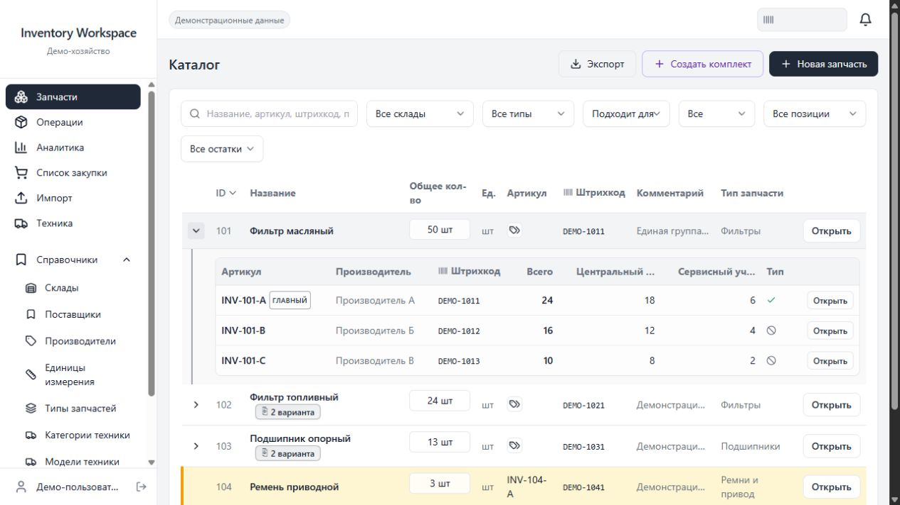
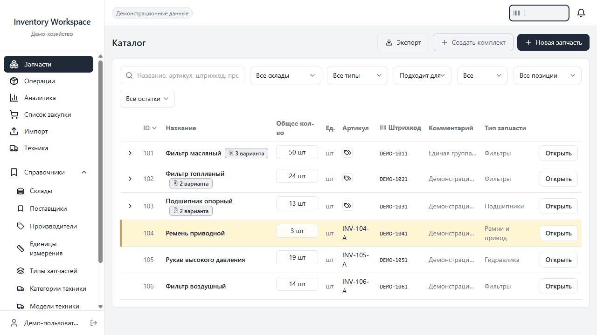

  
  

I build business software from requirements to deployment: **APIs, data models, integrations and the interfaces people use every day.** I focus on Python backend development; I also build full-stack products and coordinate technical delivery.

  <a href="https://www.linkedin.com/in/starboyshpak/">LinkedIn</a> · Stavropol, Russia

## 01 / My own B2B web product

**I created the product end to end: from the idea and UX/UI design brief to architecture, backend, frontend and deployment.** I continue to develop and maintain it.

A web platform for organizations to work with data, documents and business interactions. It brings together organization workspaces, user roles, messaging, notifications and file handling in one application.

*Generalized view of the product's capabilities. The interface and domain-specific workflows are not shown.*

**What I built**

- A modular backend with organization-level data isolation, user roles and permission checks.
- The web interface, API and data model, including transactional operations and protection against conflicting updates.
- Messaging and notifications, Excel import and Excel/PDF document generation.
- Background processing with Celery/Redis, private S3-compatible storage and file scanning with ClamAV.
- Containerized deployment, application updates and ongoing maintenance.

**Stack:** Python · FastAPI · PostgreSQL · SQLAlchemy/Alembic · Next.js · React · TypeScript · Celery · Redis · Docker Compose

## 02 / Inventory & spare-parts workspace

**A web application I built for agricultural operations.** The difficult part is the equivalent-parts catalogue: interchangeable parts need to stay connected while retaining separate manufacturer part numbers, stock balances and history.

*Actual application interface with synthetic demonstration data.*

**Engineering behind the screen**

- Equivalent-parts groups, equipment compatibility, duplicate detection and controlled reassignment between groups.
- Multiple warehouses, stock movements, purchasing lists and equipment cost analytics.
- Excel exchange, barcodes and a Telegram interface.
- Role-based access, containerized deployment and automated updates.

**Stack:** Python · FastAPI · PostgreSQL · SQLAlchemy/Alembic · React · TypeScript · Vite · Redis · Docker Compose

Explore the catalogue and variants

*A sequence of actual UI states from the isolated demo.*

I also develop Django systems and integrations in my main role, alongside leading a small automation team.

This profile presents selected project work. Source repositories and operational data remain private.
