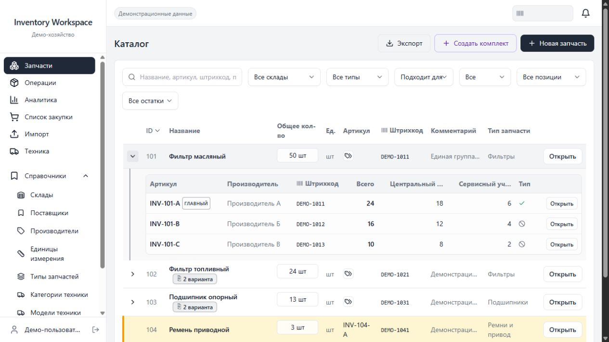
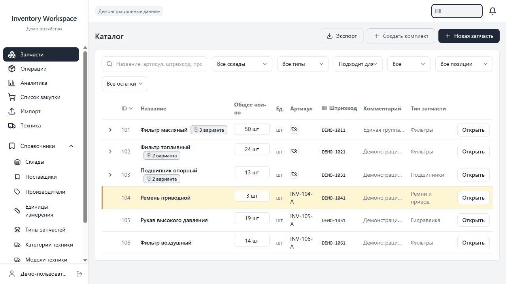

  
  

Создаю бизнес-приложения от требований до развёртывания: **API, модели данных, интеграции и интерфейсы для ежедневной работы.** Основное направление — Python backend. Также разрабатываю веб-продукты целиком и координирую техническую работу.

  <a href="https://www.linkedin.com/in/starboyshpak/">LinkedIn</a> · Ставрополь, Россия

## 01 / Собственный B2B-продукт

**Создал продукт целиком: от идеи и задания UX/UI-дизайнеру до архитектуры, backend, frontend и развёртывания.** Продолжаю самостоятельно развивать и поддерживать его.

Веб-платформа для работы организаций с данными, документами и деловыми взаимодействиями. Объединяет кабинеты организаций, роли пользователей, переписку, уведомления и работу с файлами в одном приложении.

*Обобщённая схема возможностей продукта. Интерфейс и предметные бизнес-сценарии не раскрываются.*

**Что я реализовал**

- Модульный backend с изоляцией данных организаций, ролями пользователей и проверками прав доступа.
- Веб-интерфейс, API и модель данных, включая транзакционные операции и защиту от конфликтующих изменений.
- Переписку и уведомления, импорт Excel и формирование документов Excel/PDF.
- Фоновую обработку Celery/Redis, приватное S3-хранилище и проверку файлов через ClamAV.
- Контейнерное развёртывание, обновление и сопровождение приложения.

**Стек:** Python · FastAPI · PostgreSQL · SQLAlchemy/Alembic · Next.js · React · TypeScript · Celery · Redis · Docker Compose

## 02 / Складской учёт и аналоги запчастей

**Веб-приложение для агробизнеса, которое я разработал самостоятельно.** Ключевая задача — система аналогов: взаимозаменяемые детали связаны между собой, но сохраняют отдельные артикулы производителей, остатки и историю.

*Реальный интерфейс приложения с вымышленными демонстрационными данными.*

**Что стоит за интерфейсом**

- Группы аналогов, применимость к технике, поиск дублей и контролируемый перенос вариантов между группами.
- Несколько складов, движение остатков, закупочные списки и аналитика затрат по технике.
- Обмен Excel, штрихкоды и Telegram-интерфейс.
- Ролевой доступ, контейнерное развёртывание и автоматические обновления.

**Стек:** Python · FastAPI · PostgreSQL · SQLAlchemy/Alembic · React · TypeScript · Vite · Redis · Docker Compose

Посмотреть каталог и варианты аналогов

*Последовательность реальных состояний интерфейса в изолированном демо.*

На основной работе также развиваю Django-системы и интеграции, совмещая разработку с руководством небольшой командой автоматизации.

Здесь представлены выбранные кейсы. Исходные репозитории и рабочие данные остаются закрытыми.
